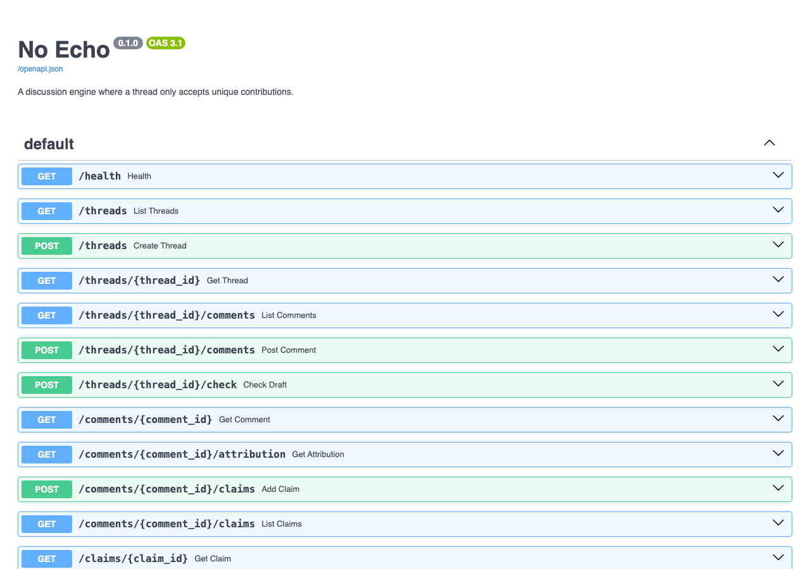

# No Echo

[](https://github.com/plutado/noecho/actions/workflows/ci.yml)
[](LICENSE)
[](https://www.python.org/downloads/)

**Status: early development (0.1.0, unreleased).** The engine core, the
uniqueness gate, the claim rules and a minimal HTTP API work and are tested.
There is no frontend, no auth, no multi-tenant support and no LLM provider
yet, and the gate threshold has not been measured against a labeled corpus.
See [What's next](#whats-next) and [ROADMAP.md](ROADMAP.md).

No Echo is an open-source, self-hostable discussion engine in which a thread
only accepts unique contributions. If a point has already been made, a new
comment making the same point does not post, and the person submitting it is
shown the comment it matched.

## What it does

- **Uniqueness gate.** Every submission is compared with the existing
  comments in its thread. Above a similarity threshold, it is blocked. The
  response includes the matched comment and the score, so the decision can be
  checked by the person it affects. Drafts can be checked before posting.
- **No popularity signals.** No votes, likes, reaction counts, "N people
  said this", or popularity sorting. The API has no field for any of them.
- **Buried attribution.** Comment listings do not include the author. The
  author is available from a separate click-through endpoint.
- **Time order only.** Chronological by default, with a reverse toggle.
- **Claims typed into five buckets.** A claim attached to a comment is
  `verified`, `unverified`, `refuted`, `disputed`, or `opinion`. Status is
  computed from attached citations, never from votes. Citing a source that is
  already attached to the claim is rejected: repeating evidence adds nothing.
- **Optional LLM features, off by default.** Pre-submit coaching and thread
  Q&A (cited synthesis kept separate from labeled gap analysis) are defined as
  a provider interface. The core needs no API key: similarity is computed
  locally.

## What's next

The full plan, with task-level estimates, is in [ROADMAP.md](ROADMAP.md).
Headline items, in dependency order:

| Milestone | What it adds | Rough hours |
| --- | --- | --- |
| 1. Dedup evaluation harness | 300+ labeled pairs, `noecho-eval` with precision/recall/F1 and a threshold sweep, CI regression check | 12 |
| 2. Adversarial rewording probes | Synonym, reordering, padding and noise attacks with evasion rates; near-miss rate limiting | 8 |
| 3. Embedding provider and pgvector | Embedding and hybrid similarity backends, Postgres store, nearest-neighbour index | 16 |
| 5. Verification workflow | Verifier-trust ADR, citation withdrawal with audit log, dead-link checks, status history | 12 |
| 6. Auth and accounts | Magic-link sign-in, pseudonymous handles, signed host tokens for embedding sites | 12 |
| 8. Embeddable widget | Framework-free thread widget with live draft check and blocked-submission view | 16 |
| 9. Thread Q&A | First LLM provider (off by default), cited synthesis and separately labeled gap analysis | 12 |

These seven come to about 88 hours. With claim parsing (10 h), multi-tenant
isolation (10 h) and operations (4 h), the roadmap totals about 112 hours.

## Who it is for

People who run a site, publication, community, or research group and want a
discussion space where reading the thread is worth the time, and who are
willing to host it themselves.

## Why

Most comment sections are shaped by their incentives. When agreement is
counted and displayed, repeating a popular point is rewarded, and provocation
is the cheapest way to get a reaction. Moderation works on the output of those
incentives and never catches up.

No Echo removes the incentives instead of policing their results. With no
counters and no visible credit, there is nothing to farm. With a uniqueness
rule, a thread grows only by adding points it does not already contain, so
each distinct position appears once regardless of how many people hold it.
The thread becomes a map of the arguments rather than a tally of the crowd.
This is a hypothesis; the project exists partly to test it.

## Built with

- Python 3.12+, managed with [uv](https://docs.astral.sh/uv/)
- [FastAPI](https://fastapi.tiangolo.com/) for the HTTP API
- SQLite via the standard library (Postgres with pgvector is on the roadmap)
- A dependency-free TF-IDF similarity backend (word and character n-grams)
- pytest and ruff

## Running it

```sh
uv sync                                   # create .venv and install dependencies
cp .env.example .env                      # optional; defaults work without it
uv run noecho-seed                        # load invented sample threads into ./noecho.db
uv run uvicorn noecho.api.app:create_app --factory --reload
```

The server reads settings from environment variables (see `.env.example`); it
does not load `.env` by itself, so export the variables or use your process
manager. Interactive API docs are at <http://127.0.0.1:8000/docs>.



## Example

Output below is from a local server started as above, against the seeded
data. It is trimmed only by shortening timestamps and dropping
`created_at` fields from the claim example.

**A repeat is blocked.** Thread 1 already contains "The garage sits two
blocks from the tram stop, so residents there could plausibly live without a
car." Submitting a reworded version of the same point:

```sh
curl -s -X POST localhost:8000/threads/1/comments \
  -H 'content-type: application/json' \
  -d '{"author": "sample-user-08", "body": "The tram stop is two blocks away, so residents could live without a car."}'
```

Response, status `409 Conflict`:

```json
{
  "blocked": true,
  "score": 0.6214,
  "threshold": 0.45,
  "backend": "tfidf-local",
  "nearest": [
    {"comment_id": 1, "score": 0.6214},
    {"comment_id": 2, "score": 0.0063},
    {"comment_id": 4, "score": 0.006}
  ],
  "matched": {
    "id": 1,
    "thread_id": 1,
    "body": "The garage sits two blocks from the tram stop, so residents there could plausibly live without a car.",
    "created_at": "2026-10-18T15:04:59Z"
  }
}
```

The person submitting sees which comment already makes the point and how
close the match was. `POST /threads/1/check` returns the same body with
status 200 and stores nothing, so a client can check a draft before posting.

**A new point passes.**

```sh
curl -s -X POST localhost:8000/threads/1/check \
  -H 'content-type: application/json' \
  -d '{"body": "The garage roof gets full sun, so it could host solar panels for the building."}'
```

```json
{
  "blocked": false,
  "score": 0.0673,
  "threshold": 0.45,
  "backend": "tfidf-local",
  "nearest": [
    {"comment_id": 1, "score": 0.0673},
    {"comment_id": 2, "score": 0.0148},
    {"comment_id": 3, "score": 0.0061}
  ],
  "matched": null
}
```

**A claim's status comes from its citations.** The seeded claim on comment 2
has one supporting and one refuting source, so it is `disputed`:

```sh
curl -s localhost:8000/claims/1
```

```json
{
  "id": 1,
  "comment_id": 2,
  "text": "Garage conversions cost more per unit than new construction.",
  "kind": "factual",
  "status": "disputed",
  "citations": [
    {"id": 1, "url": "https://example.org/studies/garage-conversion-costs", "stance": "supports", "note": null},
    {"id": 2, "url": "https://example.net/reports/adaptive-reuse-2025", "stance": "refutes", "note": null}
  ]
}
```

Attaching the first source again, even written as
`https://www.example.org/studies/garage-conversion-costs/`, is rejected
after URL normalization, with status `409 Conflict`:

```json
{"error": "duplicate_citation", "detail": "this source is already attached to the claim"}
```

## Tests and lint

```sh
uv run pytest
uv run ruff check .
uv run ruff format --check .
```

## Layout

```
src/noecho/core/      engine rules: text features, similarity, gate, claims, ordering, providers
src/noecho/storage/   SQLite store
src/noecho/service.py wires core to storage; the API calls only this
src/noecho/api/       FastAPI app and schemas
src/noecho/seed.py    invented sample data
docs/                 system design, architecture decision records, images
```

## Documentation

- [ROADMAP.md](ROADMAP.md): milestones and estimates
- [docs/system-design.md](docs/system-design.md): architecture, data model,
  API, gate design, risks
- [docs/decisions/](docs/decisions/): architecture decision records
- [CONTRIBUTING.md](CONTRIBUTING.md)

## License

MIT. See [LICENSE](LICENSE).
